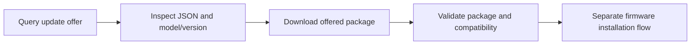

# System updates: endpoint, parameters, and examples

Check which firmware package the update service offers for a device and installed version. Querying an offer does not download or install the update.

## Endpoint

```text
GET https://aladdin-api.xgimi.com/api/update
```

The client sends URL-encoded query parameters and receives JSON. An API response reporting success is distinct from an update being available, downloaded, or installed.

## Client parameters

| Parameter | Meaning/source in the examined client tooling | X2 Plus example |
| --- | --- | --- |
| `gimiPid` | Projector identifier/serial obtained through the XGIMI factory service | Private; replace with your own value |
| `systemVersion` | Installed incremental firmware version | `V2.6.72` |
| `androidVersion` | `Android` followed by Android release | `Android9` |
| `model` | `ro.product.model` / Android model string | `popIn Aladdin 2 Plus` |
| `modelName` | `ro.xgimi.modelname`, a separate vendor identifier | Read from the intended physical device; exact value not confirmed in this published profile |
| `type` | Update family selector | `rom` for the firmware query described here |

These are fields assembled by the examined client/diagnostic work, not a verified statement of the server's minimal required parameters. The standalone local query function permits omitting `model` and `modelName`, but that does not establish that omitting them selects the correct device family.

**Do not substitute the marketing name or project identifier for an unknown field.** H0002 is the device identifier used by this project, while Android reports `popIn Aladdin 2 Plus`; the exact `ro.xgimi.modelname` value still needs a separately sourced record. It was not present in the inspected system build.prop subset. Identically numbered firmware offers can belong to different device families.

## Illustrative X2 Plus query

This request uses known version/model values, with the private serial and unconfirmed vendor-model value replaced by explicit placeholders. It is a format example, not a ready-to-run URL:

```text
https://aladdin-api.xgimi.com/api/update?gimiPid=YOUR_PROJECTOR_SERIAL&systemVersion=V2.6.72&androidVersion=Android9&model=popIn%20Aladdin%202%20Plus&modelName=VALUE_FROM_RO_XGIMI_MODELNAME&type=rom
```

Use the actual installed version for an ordinary update check. Supplying an older version in a research query asks the service a hypothetical question; it does not change the installed system or prove an upgrade/downgrade path.

## Historical X2 Plus response examples

Saved X2 Plus response examples follow. Offers can change over time and by device; these are not live results.

### Query reporting V2.6.72

The recorded result contained no offered package:

```json
{
  "code": 200,
  "data": {
    "versionName": "",
    "updateInfo": "",
    "isFullPakageUpdate": false,
    "packageDownloadUrl": "",
    "packageDownloadMd5": "",
    "upgradeMethod": ""
  },
  "message": "ok"
}
```

An empty offer means no package was returned for that query. It is not proof that V2.6.72 is permanently the latest firmware for every device or rollout group.

### Query reporting V2.6.71

A saved query reporting V2.6.71 received an offer for V2.6.72. This **excerpt** omits the Japanese `updateInfo` release notes:

```json
{
  "code": 200,
  "data": {
    "versionName": "V2.6.72",
    "isFullPakageUpdate": true,
    "packageDownloadUrl": "https://aladdin.static.xgimi.com/packages/rom/XGIMI_ALADD_II_PLUS_PA20U01DJ_FULL_V2_20240605115224.6.72.zip?",
    "packageDownloadMd5": "4b54fd4ce4a5802021aeae1cc68326e8",
    "upgradeMethod": "no_force_notice"
  },
  "message": "ok"
}
```

The trailing `?` is present in the saved URL. No firmware archive is hosted in this repository. Merely receiving a package URL does not establish that installing it on another model is valid.

## Response fields

| Field | Interpretation supported by the record |
| --- | --- |
| `code` / `message` | API-level result, separate from HTTP status and package availability |
| `data.versionName` | Offered firmware label, or empty in the no-offer result |
| `data.updateInfo` | Release-note text |
| `data.isFullPakageUpdate` | Full-package flag; the spelling `Pakage` is part of the API |
| `data.packageDownloadUrl` | Package URL returned by the service, or empty |
| `data.packageDownloadMd5` | Package MD5 value supplied by the service |
| `data.upgradeMethod` | Observed policy string, such as `no_force_notice`; full client policy semantics are not documented here |

The MD5 is useful for comparing the expected download bytes in the historical workflow; it is not a substitute for firmware signature verification or a compatibility check.

## Update check versus installation



The package-validation and installation procedure is not documented here.
