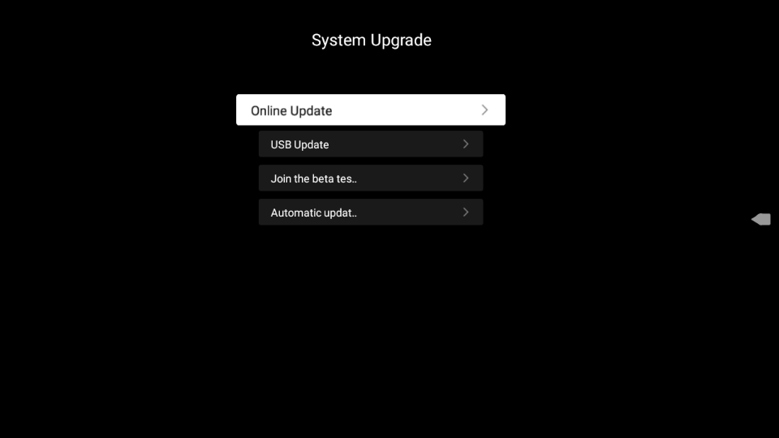

# Hidden Menus and Shortcuts

Two remote-control shortcuts for Aladdin X2 Plus firmware V2.6.72.

| Screen | Shortcut | Result |
| --- | --- | --- |
| System Update, with Install from USB selected | Hold Left | Request an ADB on/off toggle |
| Settings → Logs | Hold Right for more than 3 seconds | Open the file manager |

## ADB toggle

1. Open **System Update**.
2. Select **Install from USB** without pressing OK.
3. **Hold Left** until the ADB message appears, then release.

Repeating the shortcut requests the opposite ADB state.

**The message does not confirm that ADB started.** The settings app may lack permission to start the service even when it displays the notification.

Technical details

The USB row's key handler triggers at `getRepeatCount() == 20`, so this requires holding Left, not tapping it twenty times. The helper requests `start adbd` or `stop adbd` and displays a message without checking the command's exit status. Connection port, PC authorization, and persistence across reboot remain unverified.

## File manager

1. Go to **Settings → Logs**.
2. **Hold Right for more than 3 seconds**.
3. The file manager opens in **Chinese**.

You can browse internal files and external storage. **Copying and pasting to external storage does not work in the tested configuration.** Browsing does not grant access to every internal directory.

Technical details

Home `2.6.21.20240118` checks repeated DPAD_RIGHT events after a 3,000 ms hold and launches `com.xgimi.filemanager`. Its model check includes `popIn Aladdin 2 Plus`, the Android model string reported by this X2 Plus.

## Join beta test

The System Update screen also contains a **Join beta test** option that can be hidden on the projector.

*Android 9 x86 VM capture. The physical projector can hide this row.*

Menu visibility can be controlled by JSON item flags named `hide`. The active configuration that hides this option on the projector is still unknown; no working reveal shortcut is documented yet.

Configuration details

The native settings app (`com.android.newsettings`) binds a `mJoinBeta` view. Its shared `BaseActivity` reads `next_page_argv` item data or a JSON layout from `GimiConfigManager.getUserConfig(...)`. Matching item IDs use `hide=true` for Android `GONE`, and `hide=false` for `VISIBLE`. The exact backing file or environment variable controlling this row has not been identified.

