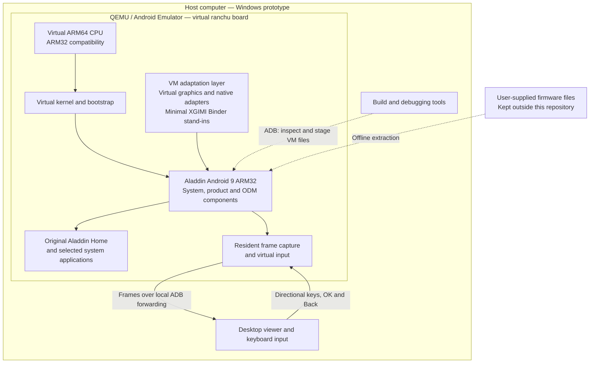

# VM architecture

The physical projector combines Android with hardware-specific services. QEMU provides a virtual machine, while a separate adaptation layer handles the differences between the projector and virtual hardware.

This is an adaptation environment built around QEMU, rather than a new QEMU implementation. The Windows host runs the emulator; Android applications and native libraries execute as ARM code inside the VM.

### Original components and VM adaptations

| Layer | Approach in the local prototype |
| --- | --- |
| Firmware inputs | Original OTA archive retained separately; extracted components used as inputs |
| Home application | Original APK preserved in the ARM prototype |
| Boot | Virtual kernel and bootstrap replace the physical boot environment |
| Graphics | Virtual EGL/gralloc libraries with targeted compatibility adjustments |
| Native hardware integration | Small VM-only adapters avoid calls that require absent projector services |
| XGIMI Binder interfaces | Minimal stand-ins provide default responses; they do not reproduce the hardware |
| Audio, codecs and storage | A mixture of original components, virtual backends, and manual setup |
| Display and controls | Custom frame viewer and virtual keyboard events |

The native adapters cover FactoryManager, SystemManager, MusicPlayerManager, and ConfigManager. Their local build checks input/output hashes and the intended byte changes. These adaptations are specific to the studied binaries and are not general firmware patches.

