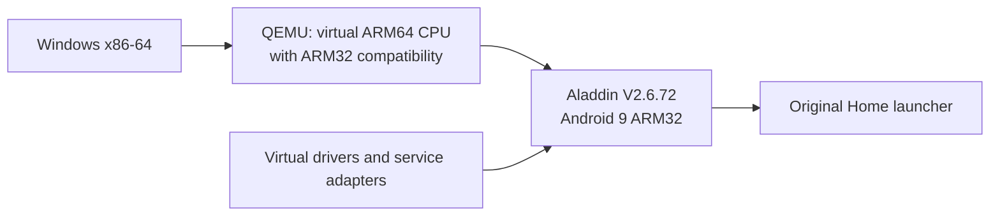

# How it works

**An experimental QEMU-based environment for running Aladdin X2 Plus firmware locally.**

Built for the **Aladdin X2 Plus (H0002)**, this project explores how its Android environment can run on a computer without the physical projector.

The target is **Aladdin V2.6.72 / Android 9 ARM32 on Windows x86-64**. QEMU emulates an ARM CPU, while adapters replace the unavailable projector hardware services. The prototype's frame stream ran at around **2 FPS** in one recorded session.



## 1. Get the firmware

**[Download Aladdin V2.6.72 firmware →](../../docs/downloads/README.md#aladdin-x2-plus-v2672-firmware)**

The download page provides the recorded vendor link, filename, and checksum. Firmware is not included in this repository.

## 2. Prepare the Windows tools and inputs

You need Windows x86-64, Python, Java 17, the compatible Android SDK/Emulator tools, and the firmware-derived inputs listed in the **[build guide](BUILD.md)**.

From the repository root, configure your local tool/input paths as described there, then build the adapters:

```powershell
python -m pip install -r .\vm\qemu\requirements.txt
python .\vm\qemu\scripts\build.py
python .\vm\qemu\scripts\build_screen.py
```

These commands build local files; they do not boot the VM.

## 3. Run the prepared VM

**The full image-preparation and boot procedure is not yet packaged.** The local prototype still relies on manual bootstrap steps, so there is no verified command here to start from only a firmware ZIP and a clean checkout.

For an already prepared and running instance, check its state:

```powershell
python .\vm\qemu\scripts\status.py --serial emulator-5582 --adb-port 5039
```

With its resident frame server already staged and running, forward the port and open the viewer:

```powershell
& "$env:ALADDIN_ANDROID_TOOLS\sdk\platform-tools\adb.exe" -P 5039 -s emulator-5582 forward tcp:38582 tcp:38582
python .\vm\qemu\scripts\viewer.py
```

Use the arrow keys to navigate, Enter for OK, and Escape for Back. The [build guide](BUILD.md#existing-vm-tools) documents the frame server prerequisites.

## Current limits

- Slow software CPU emulation; the current viewer configuration caps its 640×360 preview at 3 FPS.
- Clean boot and data export/restore are not yet reproducible from this repository.
- Projector optics, Wi-Fi hardware, calibration, and update installation are not validated by the VM.
- Windows was used for the prototype. The Linux setup has not been validated.

For implementation details, see [VM architecture](ARCHITECTURE.md). To test only the adapted Home app in a generic Android 9 x86 VM, use the separate [Home Launcher guide](../home/README.md).
